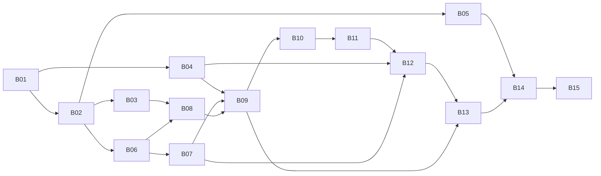

# 喷漆与多层图纸插件开发计划

> 2026-11-07 更新：[开发启动与最终验收规则](development-gates.md)优先于本文件及 Batch 原有的整批串行启动条件。B02/B03/B06/B08 等已实施，实际状态见 progress。允许保留 AutoCAD、原生转换和正式 DSH 验收缺口继续相应开发范围；全量交付门槛保留。两插件的宿主明确为 DSH。本轮只更新本地计划，未恢复暂停 goal。下文“尚未实施”等为初版规划时点说明。

版本：1.0；日期：2026-11-06（Asia/Shanghai）。本目录是后续开发的执行依据，取代旧 v0.6 中冲突或未更新的解释。**本轮只检查和编写计划；所有开发 Batch 均未开始。**

## 1. 阅读入口与执行方式

每个新聊天依次读取本文件、[当前进度](progress.md)、[接口与数据契约](contracts.md)、[项目核查基线](reference/project-baseline.md)，然后读取指定的 `batches/Bxx.md`。只读取聊天不能作为需求依据。旧 Word 是概览，不覆盖本目录。

用户在后续聊天指派某个 Batch 后，执行者先检查前置 Batch 的验收记录和当前代码，再执行本批；不能凭“代码文件存在”认定依赖完成。本轮没有授权立即创建远程项目、安装依赖、运行CAD或部署。
建议任务说明：

> 执行 docs/batches/Bxx.md。先读 docs/plan.md、docs/progress.md、docs/contracts.md 和项目基线。核实依赖已通过，只修改该 Batch 允许范围，完成真实验收并更新进度。发现阻塞时记录证据及影响，继续不受影响的工作；不要把 skipped、演示或缺失许可记为通过。保留旧几何、热仿真及其他人的修改。

本地计划根为 `C:/Users/HUAWEI/Documents/ChatGPT/插件`，当前只有规划材料和演示，不是已有新插件业务仓库。后续实施根默认命名为 `/data/qmh/satellite-plugins-20261029/dsh-satellite-drawings`（新项目，核查时不存在），下文称 **NEW_ROOT**。B01 在用户开始开发后创建并登记实际绝对路径，将本目录复制到 NEW_ROOT/docs。不要在参考仓库中创建这些模块。若目标路径已被其他项目占用，选择新目录并更新 progress 和全部定位说明，不覆盖。

未来源码、测试、脚本路径均相对 NEW_ROOT；下文是**待创建的设计路径，不表示已经实现**。参考根 G/T/S/H 的绝对路径见基线。分支使用 `codex/thermal-drawings-<batch>`。独立工作区承接已完成依赖；不要在 S 的去重分支或 H 的 dirty 工作区开发。

## 2. 产品范围与已确认决定

| 编号 | 当前执行口径 |
|---|---|
| R01 输入 | 两插件接收详细装配；先STEP，最终保留ASM/PRT。以已验证厂商/版本/依赖清单声明支持，不以扩展名承诺全覆盖。已发现Creo原生样件，不等待用户另找。 |
| R02 喷漆选择 | 人工选择实际喷漆面与范围；首个闭环为平面，源几何和装配位姿只读。 |
| R03 接触保护 | 接触距离严格小于0.1mm（可配置），结合方向和覆盖识别实际脚印；各脚印默认外扩3mm，只有真实重叠才合并，保留脚间可喷区域。 |
| R04 孔凸台筋 | 孔周围有效材料表面保护3mm；凸台保护，不默认所有凸台额外加3mm；加强筋不能仅因投影而保护。类型不确定要可人工分类。 |
| R05 多层范围 | 选择设备/面，指定安装底面、开口和突出物。默认包覆所选外形；十字布只是方盒示例，允许多裁片。 |
| R06 初始放量 | 规则方盒长宽高各乘1.05，安装底面固定、长宽居中。100mm方盒得到105mm罩内尺寸，侧隙2.5mm、顶隙5mm。不是体积乘1.05，也不是体积目标1.1。复杂外形另由B13验证构造策略。 |
| R07 搭接固定点 | 每对接缝单侧默认15mm，允许逐缝改宽度和归属。没有15%自动宽度规则。固定点可按用户指定间距生成、增删移动；不强制每个B-rep面一点或固定五点。 |
| R08 体积验收 | 最终 `1 ≤ V罩内 / V基准外形包络 ≤ 1.2`，含边界。基准保存且不随罩形调整增大；计算封口不形成实际布片；搭接用布另计。另查覆盖、穿入、开口、接缝及折回。 |
| R09 交互 | 插件中同时看三维与二维，点选/圈画后对话修改；控件与聊天调用同一业务操作；重算后同版本刷新，支持撤销重做、保存恢复。 |
| R10 交付 | 可编辑DWG、检查记录；多层另外保存可继续编辑的三维工程状态。DXF是中间格式，GLB是显示产物；不能冒充DWG或可编辑工程。AutoCAD重开兼容性保留为最终验证项。 |
| R11 工程边界 | 不做胶粘/缝合/魔术贴强度计算，不要求先选连接方式才能出图；不做外部DWG改图自动回传/反推三维、不建设通用CAD编辑器。 |
| R12 旧系统 | 旧几何、热仿真代码/接口/ID/部署/数据都不改。S/H只作代码来源，不要求cad-assembly/shared-core运行或完工；两新插件共用独立公共库与图纸后端。 |
| R13 节奏环境 | 先喷漆真实闭环，再规则多层，再复杂边界；Linux x86_64，目标平台 http://10.110.10.11:9999/。本轮不实施。 |

## 3. 两个工作流

**喷漆：** 导入完整装配 → 检查单位/位姿/缺件 → 选择喷漆面 → 距离、法向和局部覆盖识别脚印/孔/凸台 → 外扩与裁剪保护阴影 → 三维二维选中/圈画修订 → 重新检查漏保/误保 → 保存工程并导出同版本DWG → 重开编辑验收。

**多层：** 导入并选部件 → 指定底面/包覆范围/避让 → 保存基准包络 → 生成初始罩形 → 调整尺寸及开口 → 选择裁切线/折叠边/展开基面 → 展开一张或多张裁片 → 单侧15mm搭接与可调固定点 → 三维二维联动修订 → 检查最终体积比、覆盖和折回 → 保存工程、导出DWG。

失败或不确定时保留上个有效结果并显示问题。任何几何修改使旧检查和复核过期；视角改变不改变工程版本。展示成功、作业成功、规则通过和人工批准分别记录。

## 4. 目标结构和复用策略

采用两个独立插件包 + 一个共用Python图纸服务 + 一个中立几何库。前端复用原演示交互设计，真实模式采用React/TypeScript/Three.js，二维使用真实DrawingDocument生成SVG；不把原SVG三维示意当真实模型。

```text
NEW_ROOT/
  docs/{plan.md,contracts.md,progress.md,batches/,reference/}
  docs/evidence/Bxx/                 # 不含凭据或大模型的验收记录
  packages/geometry-core/src/geometry_core/
  packages/workbench-common/src/     # 共享视图、API、选择上下文、编辑控件
  packages/host-bridge/src/           # 宿主加载、代理、聊天桥
  service/src/thermal_drawings/
    api/ domain/ runtime/ storage/ importers/ paint/ blanket/ drawing/
  plugins/paint/{plugin/,web/}
  plugins/blanket/{plugin/,web/}
  contracts/                        # JSON Schema/OpenAPI，由B01起建立
  tests/{contracts,geometry,formats,runtime,paint,blanket,integration,e2e}/
  fixtures/{synthetic,manifests}/     # 小型自生成夹具；真实大文件用manifest引用
  scripts/                          # 自检、样件登记、验证、打包命令
  deploy/                           # 新后端独立部署，不复制旧服务启动器
```

包名设计为 `@satellite-drawings/paint-plugin`、`@satellite-drawings/blanket-plugin`；workspace和MCP namespace分别为satellite-paint与satellite-blanket。构建包内包含共享前端/桥接代码，运行时不通过源码相对路径寻找公共包。宿主身份必须从宿主解析，不再打包第二套dsh-tools实例。

B01选择并锁定兼容版本；Node至少22（参考热插件要求），Python版本以CadQuery/OCP支持和Linux实测为准，不沿用旧venv作为生产依赖。后端建议以可独立运行的进程提供服务，打包OCI容器及启动说明；转换器可作为独立受控worker。许可不允许打包时不强行捆绑。新部署模式在B01形成ADR，B15实现验证；旧Docker入口不参与。

| 来源 | 复用范围 | 明确排除 |
|---|---|---|
| S/backend/geometry（完整前缀见基线） | XCAF、bounds、transforms、topology、solid_pairs、STEP/GLB序列化，先做特征化验证再提取 | 旧业务ID/路由/数据库；绝对导入backend.*需解除 |
| G/T/plugin | 宿主workspace、同源消息、session隔离、认证代理、MCP桥 | 旧包名、旧会话绑定、旧token、旧工程目录、自动公开skill注册 |
| G/web | Three.js显示/高亮交互方式 | 把组件选择误当已具备精确面选择；不同Three.js版本直接混用 |
| ZIP frontend/dist/assets | 选面/阴影/搭接/固定点/撤销交互；demo provider | 430ms假作业、预置脚印和盒体代替live结果 |
| 旧geometry_jobs | 参考冻结输入、worker隔离、取消及发布语义 | 整套复制RequestProjectContext、旧账号JobStore和binding |

提取一项几何能力先固定来源提交、记录输入/算法/策略差异，再比较提取前后结果。保留C++底层及Python/OCP编排，不为统一架构重写内核。两个新调用方共用后才能称新系统内部去重；不宣称全旧系统重复代码已经删除。

## 5. Batch依赖与交付

| Batch | 交付主题 | 前置依赖 |
|---|---|---|
| [B01](batches/B01.md) | 独立工作区、契约、夹具与验证入口 | 无 |
| [B02](batches/B02.md) | STEP/XCAF、变换和序列化中立库 | B01 |
| [B03](batches/B03.md) | 距离/求交/面片中立库 | B02 |
| [B04](batches/B04.md) | DXF→DWG最小出图链路 | B01 |
| [B05](batches/B05.md) | 原生ASM/PRT工具与样件转换 | B02 |
| [B06](batches/B06.md) | 工程/资产/版本/任务服务与STEP导入 | B02 |
| [B07](batches/B07.md) | 两插件宿主骨架、真实视图和选择桥 | B06 |
| [B08](batches/B08.md) | 喷漆真实脚印与保护算法 | B03、B06 |
| [B09](batches/B09.md) | 喷漆联动编辑及DWG真实闭环 | B04、B07、B08 |
| [B10](batches/B10.md) | 规则多层罩形与体积评价 | B02、B06、B09 |
| [B11](batches/B11.md) | 展开、接缝、搭接与固定点 | B10 |
| [B12](batches/B12.md) | 多层联动编辑及DWG真实闭环 | B04、B07、B11 |
| [B13](batches/B13.md) | 复杂外形、曲面和修订边界 | B09、B12 |
| [B14](batches/B14.md) | 原生导入集成和真实案例总验收 | B05、B06、B09、B12、B13 |
| [B15](batches/B15.md) | Linux打包、平台隔离安装及交付 | B14 |



表格是依赖的完整定义，图省略部分传递边。B04/B05应尽早验证，不等全部业务完成。B04可与B02分别推进；B05在B02完成后使用同一STEP读回器，可与B03/B06分别推进，避免重复实现解析。共改schema必须串行合并并做契约回归。B05若受许可阻塞，STEP方向可继续，但B14/B15不能按完整交付通过。B04若仅DXF通过，DWG仍阻塞，不能把B09/B12的最终出图验收降级为DXF。

## 6. 验证入口与通过语义

B01实现 `scripts/verify_batch.py`，参数约定：
```bash
python scripts/verify_batch.py Bxx --report-dir docs/evidence/Bxx
```
运行前在NEW_ROOT激活B01创建的环境；每批给出准确测试路径和外部运行命令。上述脚本及所有新增测试**目前不存在，由对应Batch创建**，不能在计划阶段运行后声称通过。
统一runner必须运行该批登记的测试，核查要求的真实产物和人工验收证据，并输出 `summary.json`。缺依赖/工具/许可/证据/必需样件时非零退出并记录blocked，不能因空测试、skip或mock通过而放行。

验收报告至少包括：Batch、代码commit/dirty、工具及库版本、输入manifest/hash、命令和退出码、必测/通过/失败/跳过数量、产物hash、检查结果、人工复核范围、已清理的隔离资源、遗留项及下一批。报告不得存放密钥、真实账号token或嵌入大模型；模型放受控资产区。

简单解析几何夹具允许使用测试oracle精度：长度绝对误差1e-6mm、面积/体积相对误差1e-6（近零用显式绝对界），仅验证数值实现，不作为制造公差。原生转换、真实工程和近阈值不确定区按案例记录容差及依据；无依据不能默认判pass。0.1mm是业务距离阈值，绝不当OCCT fuzzy tolerance。

只有测试+必需实物文件验证+必要人工检查全部满足才标completed。批内有限失败可记录needs_review，但必需范围未通过不能完成。复杂非可展曲面不能靠“unsupported”提示即算交付；应实现分片/受控近似并按误差和案例验收，制造误差需求无法确定时该场景保持blocked，不影响已验收范围。

## 7. 人工决定的边界

已确定的1.05线性放量、15mm搭接、1～1.2体积比及插件内编辑不再追问。代码布局、算法候选和部署技术由开发方选择并验证，不列成用户待办总表。
只在会影响授权或工程意义时请人决定：商业软件/SDK采购或许可授予，目标厂商版本范围超出已有样件，指定AutoCAD验收环境不可用，真实公差/特殊孔凸台工艺无可靠依据，复杂曲面制造近似方案，缺少的人工真值，或需要改变平台全局配置。各批写明触发条件、推荐做法、阻塞范围；不凭等待时间当批准。

## 8. 最终交付

两个可安装插件包；独立后端及中立几何库；可重建环境与部署说明；用户操作说明；脱敏案例manifest；原生格式能力矩阵；可编辑DWG及重开证据；可保存恢复的三维多层工程；自动/人工验收记录。
要求旧服务无变化、无cad-assembly运行依赖、前后端无凭据泄漏、两个视图与导出同版本。没有实际验证的厂商版本不得进入支持清单。本计划不宣称已实现任何新业务。
