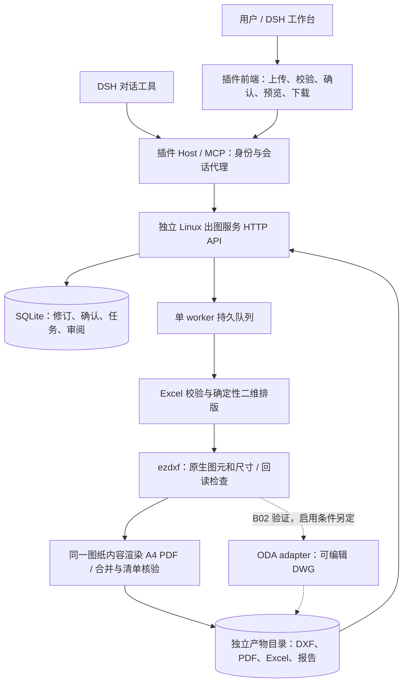

# 矩形加热器自动出图插件开发计划

本轮有效决定（2026-11-09，已纳入最新继续推进授权）：用户接受 fix-12 外观及当前 PDF 字体作为开发基线，技术要求右移3mm、上移8mm；引线采用统一短边纸面比例规则。先在5090宿主机 FreeCAD 0.19.2（无Docker）实际编辑/更新/保存/关闭/重开，并分开报告 FCStd 与 DXF 结果。开发技术门槛与加工交付审批分开；正式具名工程批准留到交付前，AutoCAD 兼容性为未验证，不因尚无具名人员阻塞本轮。产品DWG继续延期。最新授权允许在B02独立技术验收通过且满足后续依赖后由调度继续推进；只有确实阻断必要依赖且无法解决时停相应批。当前执行者只完成B02，不自行开后批。详见 [开发基线决定](decisions/B02-development-baseline.md)。
版本：1.1 · 2026-11-09 · 状态：B02开发基线实施，交付审批另行。

## 1. 要做什么

在鼎星 DSH 平台导入 Excel，以固定工程模板批量生成矩形加热器图纸，供工程人员复核后交付加工或采购。首版基线为可编辑汇总 DXF、逐代号纵向 A4 PDF、合并 PDF、原始及实际出图 Excel、逐行报告和产物清单。

**开发初期先验证真实二维图元 → DXF → PDF，并立即评估 DXF → ODA → DWG → 回读及 CAD 编辑保存链路，不先做完业务再试转换。** 当前 DWG 是有条件扩展，不是已经承诺通过的交付项。B02 必须留下可复核结论；若获准纳入首版，须先更新格式契约及后续验收。转换不通过时，不把 DXF 改后缀或回读成功描述成 DWG 完整通过。

初始计划阶段仅整理文档；本轮按用户新授权实施B02，历史v0.6/v0.8/v0.9及fix-12证据保留。

## 2. 已确定的产品边界

| 项目 | 约定 |
|---|---|
| 运行 | Linux 独立微服务、前后端分离；独立虚拟环境＋systemd，**不使用 Docker，也不调用旧 CAD 容器执行** |
| 平台 | SSH `5090-qmh`；应用入口 `http://10.110.10.11:9999/`，登录及安装兼容性另验 |
| 输入 | 案例 17 个 Excel 字段；普通修改重新上传；动态内容以 Excel 为准 |
| 模板 | 固定纵向 A4、黄色图框、固定技术要求；允许规范化标注避让；不识别任意模板 |
| 几何 | 宽≤长；短边顶部居中双引线，长边左侧居中双引线，正方形顶部；真实尺寸标注 |
| 比例 | 优先输入比例；超框推荐比例，确认后应用；唯一网页数据修改例外，保留原值和最终 Excel |
| 错误 | 有错误先暂停；用户修正重传或明确确认跳过指定行；不得默认跳过 |
| 合并 | 只对冻结的预期出图集合发布；全部预期行通过才产生正式汇总文件，防止合并 PDF 漏页 |
| 审核 | 生成成功与人工复核通过分别记录；未复核产物可预览和下载送审，不能显示可交付加工 |
| 不做 | 电热设计、热仿真、三维贴装、蛇形电阻线设计、喷漆/多层业务、通用 CAD 编辑器、旧服务迁移 |

完整字段、模板文字、边界及案例见 [需求基线](reference/requirements.md)。运行与 API 约束见 [契约](contracts.md)。

## 3. 整体架构



Host 保管服务凭据，浏览器不直接获得令牌。服务由 API 与 worker 两个 systemd 单元组成，采用同一独立 Python 环境，SQLite 持久化任务，磁盘按 owner/session/job/revision/run 隔离。首版一个 worker 顺序出图，不引入 Redis/Celery、分布式调度或几何内核。AI 仅调用受限工具，不生成任意执行代码，不代替用户确认比例、跳过或复核。

技术选型：Python 3.12、FastAPI/Pydantic、openpyxl、ezdxf、Matplotlib（候选 PDF renderer）、pypdf；前端 React/Vite，Host/MCP 使用既有 DSH 的 ESM 接入模式。具体可安装版本在 B01 锁定；PDF renderer 必须经 B02 字体和版式验证，不把候选写成已可用能力。

## 4. 项目位置与代码边界

本计划根：`C:\Users\HUAWEI\Documents\ChatGPT\插件\heater-drawing`。同级 `..\docs` 属于喷漆与多层项目，不得覆盖或挪用进度。

拟开发根：`/data/qmh/satellite-plugins-20261029/dsh-satellite-heater-drawing`，2026-11-07 核查尚不存在。B01 在该独立目录初始化；将本目录的完整 docs 同步进去后，它成为执行、代码与验收记录的权威根。若届时目录已存在，先核对身份和改动，再续用，不覆盖。文中除明确标明本地/远端绝对路径外，文件均相对此开发根。

```text
docs/                         本计划、契约、Batch、进度、报告与证据
schemas/                      共享 JSON Schema / OpenAPI 快照
service/pyproject.toml         独立 Python 包及锁定依赖
service/src/heater_drawing/    domain、excel、drawing、delivery、api、jobs、storage
templates/heater-a4-v1/        受控 DXF 模板、字体配置、布局参数、版本清单
fixtures/{case,invalid}/       原案例副本、错误与边界夹具
web/                          工作台前端
plugin/                       DSH Host、MCP、打包配置
scripts/                      验收、真实格式探针与部署检查
tests/                        合同、图纸、任务、安全隔离与端到端测试
deploy/                       systemd 单元、环境示例、安装/回滚说明
```

上列业务目录均是**计划新增**，不是已有实现。既有 geometry/thermal/shared-core 和 `dsh-satellite-drawings` 仅读取参考；不导入其私有包，不共用其可变环境、数据库、运行目录或工具身份。[项目核查](reference/project-baseline.md)给出真实代码锚点与限制。

## 5. Batch 顺序与依赖

| Batch | 交付边界 | 前置依赖 | 关键门槛 |
|---|---|---|---|
| [B01](batches/B01.md) | 独立项目、输入材料、契约与验收入口 | 无 | 隔离边界、材料 hash、可复现环境 |
| [B02](batches/B02.md) | 固定模板及真实 DXF/PDF 小样；提前核查 DWG | B01 | 模板/字体/编辑性实测，格式选择记录 |
| [B03](batches/B03.md) | Excel 解析与逐行校验 | B01 | 17 字段、行号、错误、数量原文准确 |
| [B04](batches/B04.md) | 真实尺寸、比例推荐、排版与 DXF 批量引擎 | B02、B03 | 1:1/1:2、出线、原生尺寸、超框检查 |
| [B05](batches/B05.md) | PDF 与完整交付包 | B04 | 页数/顺序/集合一致、无漏页 |
| [B06](batches/B06.md) | HTTP 服务、持久任务和确认/失败恢复 | B05 | 暂停、明确跳过、修订隔离、原子发布 |
| [B07](batches/B07.md) | DSH Host/MCP 与插件包 | B06 | 可信会话、凭据代理、宿主兼容 |
| [B08](batches/B08.md) | 工作台完整操作流程 | B07 | 用户能理解错误、比例、跳过及送审状态 |
| [B09](batches/B09.md) | 真实案例端到端与工程人工验收 | B08 | 真实格式编辑、图面、异常和隔离通过 |
| [B10](batches/B10.md) | 无 Docker 安装、升级、回滚与移交 | B09 | 目标 DSH 使用及 systemd 运维实测 |

依赖图允许 B02/B03 在 B01 后实施；最新用户授权允许在独立技术验收通过、满足后批依赖后由调度继续推进；当前B02执行者仅负责本批。**B02 的 DXF/PDF/模板门槛是必须项；DWG 延期有明确决策记录不等于 B02 自动失败，也不等于 DWG 成功。** 若决定首版必须 DWG，则新增该门槛，未通过之前 B04 不进入完整业务开发。

## 6. 新聊天如何执行

1. 阅读本文件、[progress.md](progress.md)、[contracts.md](contracts.md)、目标 Batch 和其前置报告；检查当前 Git 状态与适用 AGENTS.md。
2. 确认开发根身份；B01 负责首次创建，其余禁止把同级喷漆/多层项目当本项目。
3. 前置 Batch 必须有 `passed` 及证据；依赖变化时重验受影响项。历史聊天结论、mock 或另一个插件的通过记录不能代替本项目验收。
4. 按 Batch 实现和验收，只修改归属文件；需要改变范围、契约或人工决定时先记录实际影响。用户确认不从等待时长、AI 推断或旧许可跨项目继承。
5. 输出 `docs/reports/Bxx.md` 与 `docs/evidence/Bxx/summary.json`，更新进度。记录源码版本/脏状态、执行命令、退出码、输入和产物 SHA-256、失败及待审事项。不把缺失验收写成通过。

可直接用于新聊天的任务说明：

> 在独立 dsh-satellite-heater-drawing 开发根执行 docs/batches/Bxx.md。先读取 docs/plan.md、docs/progress.md、docs/contracts.md 及前置报告，核对当前代码。仅完成本 Batch，运行指定验收并记录真实证据，更新 progress。禁止修改旧几何/热/喷漆多层项目、使用 Docker，或代替人工确认。若缺前置条件，记录阻塞和可继续的独立工作。

## 7. 人需要把控的节点

| 时点 | 需要决定/审阅 | 不应交给人工猜测的内容 |
|---|---|---|
| B02 | 开发外观基线、统一引线规则、FreeCAD实际测试；DXF/PDF基线、DWG延期；具名审批留交付前 | 先提供样件、可编辑对象检查、Linux/许可事实及失败证据 |
| B03/B04 | 有偏离案例的输入格式或比例清单需求时确认 | 默认输入约束和建议比例见需求与契约，不重复询问已确认规则 |
| 每次运行 | 推荐比例、明确跳过清单、最终工程复核 | 系统先给出逐行原因、剩余页数和确切产物 |
| B09 | 工程样图与交付流程签收 | 先完成自动核验和差异清单；不靠人工查出系统已知错误 |
| B10 | 生产账户/路径/端口、安装窗口；若启用 DWG 则许可范围 | 先完成可审查安装包、测试环境验证、回滚方案 |

允许先完成技术准备，再等待相应人工门槛；不要以这些未来事项为由停止本次计划编写。当前仅承诺计划，不声称任何开发 Batch 已完成。
